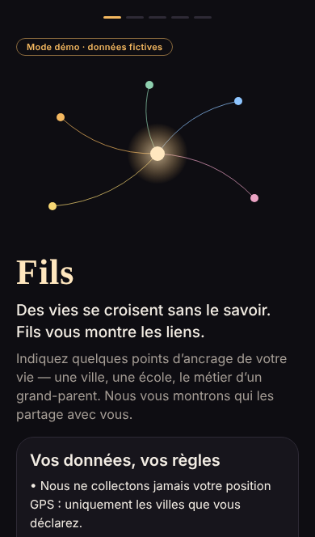
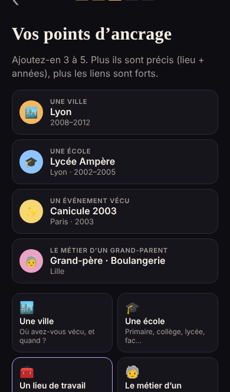
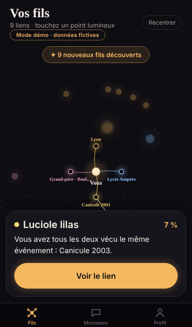
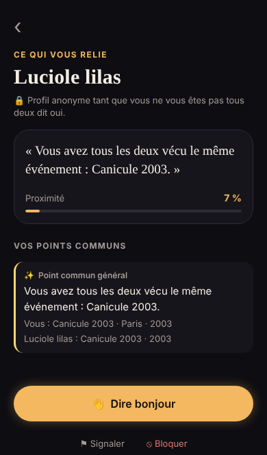

# Fils — prototype

> Des vies se croisent sans le savoir. Fils vous montre les liens.

Chaque personne déclare 3 à 5 **points d'ancrage** de sa vie : une ville et une période, une école, un lieu de travail, le métier d'un grand-parent, un club, un événement vécu. Fils relie automatiquement les personnes qui partagent des ancrages précis. Il dessine ensuite un graphe lumineux de ces liens inattendus, centré sur soi.

Stack : **Expo SDK 58 / React Native 0.88 (TypeScript)**, Expo Router, react-native-svg, Reanimated 4, Gesture Handler 3 et **Supabase** (auth, Postgres + RLS, Realtime).

| Accueil + RGPD | Ancrages | Découverte | Graphe | Fiche de lien | Messagerie |
|---|---|---|---|---|---|
|  |  |  |  |  |  |

---

## 1. Architecture

```
fils/
├── src/
│   ├── app/                      # Écrans (Expo Router : 1 fichier = 1 route)
│   │   ├── _layout.tsx           # Providers (gestes, safe area, thème, état) + Stack
│   │   ├── index.tsx             # Aiguillage : onboarding ou graphe
│   │   ├── onboarding/           # 5 écrans
│   │   │   ├── index.tsx         #  1. Bienvenue + consentement RGPD + âge
│   │   │   ├── pseudo.tsx        #  2. Pseudo
│   │   │   ├── anchors.tsx       #  3. Points d'ancrage guidés (3 à 5)
│   │   │   ├── visibility.tsx    #  4. Ce que les autres verront → création du profil
│   │   │   └── reveal.tsx        #  5. La « découverte » (compteur + 1re coïncidence)
│   │   ├── (tabs)/
│   │   │   ├── index.tsx         # Graphe interactif (écran principal)
│   │   │   ├── messages.tsx      # Demandes reçues / conversations / en attente
│   │   │   └── profile.tsx       # Ancrages, visibilité, blocages, export, suppression
│   │   ├── anchor-editor.tsx     # Modal : créer / modifier un ancrage (autocomplétion)
│   │   ├── link/[id].tsx         # Fiche de lien : pourquoi, Dire bonjour, accepter, bloquer, signaler
│   │   └── chat/[id].tsx         # Messagerie 1-à-1 (temps réel)
│   ├── core/                     # Logique pure, sans React : testable, portable en Edge Function
│   │   ├── types.ts              # Modèle de données
│   │   ├── scoring.ts            # ★ Algorithme de score + phrases « pourquoi »
│   │   ├── graphLayout.ts        # Mise en page radiale moi → ancrages → personnes
│   │   ├── anonymize.ts          # Pseudonymes anonymes stables (« Luciole ambre »)
│   │   ├── normalize.ts          # Clés normalisées (slug) + matchKey
│   │   └── anchorText.ts         # Libellés d'ancrages
│   ├── data/
│   │   ├── catalog.ts            # Suggestions : villes, écoles, métiers, activités, événements
│   │   └── demoProfiles.ts       # 50 faux profils déterministes
│   ├── services/
│   │   ├── repository.ts         # Contrat unique UI ↔ backend
│   │   ├── demoRepository.ts     # Mode démo 100 % local (AsyncStorage), réponses simulées
│   │   ├── supabaseRepository.ts # Backend réel
│   │   └── index.ts              # Choix automatique selon les variables d'environnement
│   ├── state/AppContext.tsx      # État global + calcul des liens
│   ├── components/               # UI : graphe, lignes d'ancrage, autocomplétion, boutons…
│   ├── i18n/                     # fr.ts (tous les textes) + t('clé', {params}) typé
│   └── theme/                    # Palette sombre et chaude, couleurs par type d'ancrage
├── supabase/
│   ├── migrations/20261108000000_fils_schema.sql   # Schéma + RLS + fonctions
│   └── seed.sql                  # 50 profils de démo (généré)
└── scripts/
    ├── check-scoring.ts          # Vérifications de l'algorithme (npm run test:scoring)
    └── generate-seed.ts          # Régénère supabase/seed.sql
```

**Flux de données.** L'UI ne parle qu'à l'interface `Repository`. Sans variables Supabase, l'app démarre en **mode démo** : 50 faux profils, tout reste sur l'appareil, et les profils répondent aux « bonjour » au bout de quelques secondes. Avec Supabase, le serveur ne renvoie que les ancrages **en commun** avec les miens. Le score est ensuite calculé sur l'appareil, par le même module `core/scoring.ts`.

---

## 2. Lancer le projet en local

Prérequis : Node 20+ et npm. Pour un téléphone : l'app **Expo Go** ou un *development build* (voir plus bas).

```bash
cd fils
npm install
npm run web        # ouvre http://localhost:8081 : le plus rapide pour essayer
npm start          # QR code pour Expo Go / simulateurs (touche i = iOS, a = Android)
```

Sans configuration, l'app démarre en **mode démo** : un badge « Mode démo · données fictives » le signale.

> Astuce démo : choisissez des ancrages autour de Lyon, Paris, Lille, Nantes, Marseille, Bordeaux… (ex. *Lyon 2008-2012*, *Lycée Ampère 2002-2005*, *Canicule 2003 à Paris*). Environ 9 secondes après l'inscription, un de vos fils vous dit bonjour.

Autres commandes :

```bash
npm run typecheck      # tsc --noEmit
npm run test:scoring   # vérifie l'algorithme (ordre des scores, phrases, ancrages masqués…)
npm run seed:generate  # régénère supabase/seed.sql depuis src/data/demoProfiles.ts
```

### Avec un vrai backend Supabase (local)

```bash
npm i -g supabase            # ou: brew install supabase/tap/supabase
supabase init                # crée supabase/config.toml (garder migrations/ et seed.sql)
# Dans supabase/config.toml, section [auth] :  enable_anonymous_sign_ins = true
supabase start               # Postgres + Auth + Realtime en local (Docker)
supabase db reset            # applique la migration puis seed.sql (50 profils)
cp .env.example .env         # puis renseigner :
#   EXPO_PUBLIC_SUPABASE_URL=http://127.0.0.1:54321
#   EXPO_PUBLIC_SUPABASE_ANON_KEY=<anon key affichée par `supabase start`>
npm start
```

Sur un projet hébergé : `supabase link --project-ref <ref>`, puis `supabase db push`. Activez *Anonymous sign-ins* dans Authentication → Providers. N'appliquez **pas** `seed.sql` en production.

### Build iOS / Android

Le prototype n'utilise que des modules inclus dans Expo Go. Pour les stores : `npx eas-cli@latest build --profile production`, puis `eas submit`. Les identifiants `app.fils.prototype` sont définis dans `app.json` et doivent être remplacés.

---

## 3. Algorithme de score (résumé)

Le détail commenté se trouve dans `src/core/scoring.ts`. Chaque paire d'ancrages comparables (même type et même `matchKey`) reçoit un poids :

```
poids = BASE[type] × facteurLieu × facteurTemps × facteurRareté      (≤ 0,95)
score = 1 − Π(1 − poidsᵢ)       (appariement glouton : chaque ancrage compte une fois)
```

| Facteur | Valeurs |
|---|---|
| BASE | école 0,60 · travail 0,55 · club 0,40 · grand-parent 0,35 · ville 0,30 · événement 0,15 |
| Lieu (grand-parent, club, événement) | même ville ×1 · villes différentes ×0,35 · inconnue ×0,5 |
| Temps | chevauchement ×1 à ×1,2 · écart de 1 à 5 ans ×0,75 → ×0,43 (10 ans pour les grands-parents) · plus loin ×0,3 · non daté ×0,5 |
| Rareté (IDF) | ×1 (partagé par très peu de profils) → ×0,6 (partagé par tous) |

On obtient bien **même ville + même époque > même ville à 3 ans d'écart > même ville seulement**. Ces relations sont vérifiées par `npm run test:scoring`. La coïncidence la plus forte devient la phrase « pourquoi », par exemple : *« Vous êtes passés par la même école, Lycée Ampère à Lyon, à 3 ans d'écart. »*

---

## 4. Confidentialité et sécurité (déjà en place)

- **Pas de GPS** : aucun module de localisation. Les lieux sont des clés de ville déclarées (`city_key`).
- **Anonymat jusqu'à l'accord mutuel** : un pseudonyme aléatoire stable est affiché. Le vrai pseudo n'est lisible (RLS sur `profiles`, et `match_candidates()`) que si la connexion est `accepted`.
- **Ancrages privés** : la RLS interdit de lire les ancrages d'autrui. La fonction `match_candidates()` ne renvoie que les ancrages qui recoupent les miens, pour des profils découvrables et non bloqués.
- **Messagerie verrouillée** : on ne peut insérer et lire des messages que sur une connexion acceptée et non bloquée. Le statut ne change que via `respond_connection()`, et seulement par la personne sollicitée.
- **« Dire bonjour »** n'est possible que vers un profil découvrable, non bloqué, avec qui on partage au moins un ancrage.
- **Bloquer** supprime aussitôt la connexion et les messages (trigger). **Signaler** crée une entrée dans `reports`, que l'auteur ne peut pas relire.
- **RGPD** : consentement explicite et versionné (`consent_version`, `consent_at`), vérification d'âge (15 ans), visibilité par ancrage, mode invisible, **export JSON** (portabilité) et **suppression en un geste** (`delete_my_account()` → cascade).
- Limite de 10 ancrages par compte, pour freiner l'énumération.

---

## 5. Reste à faire avant publication

**Modération et sécurité**
- [ ] Back-office de modération des `reports` (service_role), sanctions, et statistiques de signalements par compte.
- [ ] Filtrage automatique des messages (insultes, coordonnées, liens) et limitation de débit des « bonjour » (ex. 10 par jour), via une Edge Function ou un trigger.
- [ ] Anti-énumération : limiter les appels à `match_candidates()`, imposer un délai entre les modifications d'ancrages, détecter les profils qui balaient des villes ou années.
- [ ] Révoquer l'exécution publique des fonctions utilitaires (`is_blocked`, `shares_anchor`, `is_accepted_peer`) ou les déplacer dans un schéma privé.
- [ ] Vérification d'âge plus robuste, et règles spécifiques pour les mineurs.
- [ ] Lier le compte anonyme à un e-mail ou à « Se connecter avec Apple / Google » (Apple l'exige si un login tiers est proposé), avec récupération de compte.

**Juridique**
- [ ] Mentions légales, CGU, politique de confidentialité complète (responsable de traitement, DPO, sous-traitants comme Supabase, région d'hébergement UE, durées de conservation).
- [ ] Analyse d'impact (AIPD) : les métiers ou origines des grands-parents peuvent toucher des données sensibles. Prévoir un registre des traitements.
- [ ] Bannière de consentement si des outils d'analyse sont ajoutés. *Privacy Nutrition Labels* (App Store) et *Data safety* (Play Store).
- [ ] Contacts de signalement conformes au DSA, et procédure de réponse aux autorités.

**Produit et technique**
- [ ] Notifications push (expo-notifications) pour un nouveau fil, un bonjour reçu, une acceptation ou un message, avec réglages fins et heures calmes.
- [ ] Calcul des liens côté serveur (Edge Function avec le même `scoring.ts`), en cache et incrémental, pour passer à l'échelle.
- [ ] Référentiels serveur (villes INSEE, établissements scolaires via l'annuaire de l'Éducation nationale, nomenclature des métiers) à la place des catalogues locaux.
- [ ] Types TypeScript générés (`supabase gen types`), tests unitaires et e2e (Jest, Maestro ou Detox), CI.
- [ ] Accessibilité : alternative en liste au graphe pour les lecteurs d'écran, tailles de texte dynamiques.
- [ ] Traductions (`src/i18n/en.ts`…) et détection de la langue de l'appareil.
- [ ] Icône, écran de démarrage, nom définitif, identifiants de bundle, comptes développeur Apple et Google, pipeline EAS.
- [ ] Monitoring (Sentry) et sauvegardes de la base.
